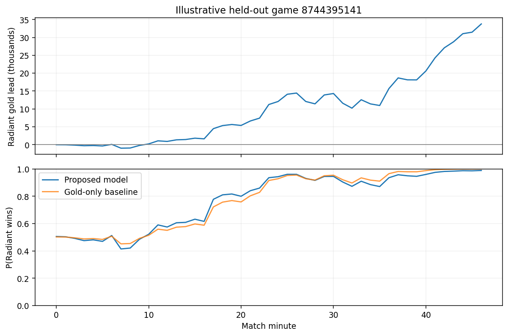

# Live Dota 2 Win Probability

**Truong Quang Sang · Vexil Capital · Senior Data Scientist take-home · 15 November 2026**

**Research question:** Is the same gold lead equally informative at minute 10 and minute 30? I started with the required gold-only logistic baseline, tested one time-dependent alternative, and evaluated what the richer model buys once uncertainty and late-game failures are taken seriously.

**Result:** On 106 held-out professional matches, M1 improved log loss from **0.5164 to 0.5040** and Brier from **0.1719 to 0.1684** versus M0. A later 200-game development cohort also favors M1 on aggregate point scores. The original TEST paired 95% intervals still include zero, and the observed 30+ Brier reversal is **inconclusive**, not proof of late-game failure. I would retain M0 as the benchmark and shadow-test M1.

## 1. Study design and data integrity

I collected **500 parsed professional OpenDota matches**, 250 from patch 59 and 250 from patch 60, using the permitted `/proMatches` and `/matches/{match_id}` endpoints. They cover **21–26 March 2026**, a short **5.26-day** patch-transition window. The study is intentionally reproducible but not representative of later patches or all leagues.

The **18,292 minute-level rows are forecast opportunities, not independent game outcomes**. For a forecast at game minute *t*, economy arrays use indices at most *t*; event features use timestamps no later than `60*t`. Parsed player minute clocks are checked against aggregate team economy. Winner, post-game totals, future events and final duration do not enter features. The corrected notebook imposes the **strict pre-terminal** condition `60*t < duration`: an audit found and removed 12 end-boundary rows (8 TRAIN, 3 VALIDATION, 1 TEST). This was a correction **after the original TEST was opened**, not a second blind evaluation.

Matches are ordered chronologically and entire professional series stay in one partition: **291 TRAIN / 103 VALIDATION / 106 TEST**, with **10,675 / 3,781 / 3,836** minute rows. TRAIN contains 41 patch-60 games; both later partitions are entirely patch 60. This tests later games within the observed environment, **not generalization to an unseen patch**. Five TRAIN games have estimated end times later than the first VALIDATION start (at most 1,606 seconds); removing them in a development-only sensitivity did not change selection. Retrospective event timestamps do **not** prove when a live consumer received a packet or a finished result.

## 2. Model design and the falsification test

I fixed the four interpretable candidates before the primary held-out comparison. Each uses train-only preprocessing and L2 logistic regression (`C=1`). I selected the challenger by **validation log loss**, not by TEST.

| Model | Minute-*t* inputs | Validation log loss | Brier |
| --- | --- | ---: | ---: |
| **M0 · Required baseline** | Gold difference | 0.5325 | 0.1811 |
| **M1 · Time value** | Gold, minute, gold × log(1 + minute/10) | **0.5197** | **0.1759** |
| M2 · Lead fragility | M1 + XP + trailing five-minute gold/XP change | 0.5224 | 0.1778 |
| M3 · Objective conversion | M2 + timestamped towers, barracks, Roshan, kills | 0.5282 | 0.1806 |

The point of M1 is not complexity. It asks whether a gold difference has time-varying predictive value. M2 and M3 supplied plausible additional information, yet their validation scores worsened. That is a reason to prefer the smaller model **for this sample**, not to declare economic or objective features universally useless.

---

## 3. What the model actually learned

At a **fixed +2,000 Radiant gold lead**, M1 predicts **66.5%** Radiant win probability at minute 10 and **59.4%** at minute 30. TRAIN contains at least +2k gold leads in 60/291 minute-10 games and 87/214 minute-30 games. This **single-fit point contrast** combines the elapsed-minute main effect and the interaction; it has no uncertainty interval and is **not** causal. Figure 1 restricts display to regions supported by at least 10 distinct nearby TRAIN games.

*Figure 1. Conditional M1 scenarios, not actual game trajectories or interventions.*

A second view is closer to the deliverable: **minute-by-minute probability movement in a real held-out game**. I selected the game with the largest within-game **range** of gold advantage, without selecting on prediction error or outcome. The two models largely track the same changing game state, but produce different probabilities at the same minute. This makes clear why the unit of work is an updated probability, not one prediction per match.

*Figure 2. Descriptive illustration, game 8744395141. Selection was based on observed gold range, not forecast accuracy.*

## 4. What did not survive model selection

I explored economy concentration (S2), strategic options (M4), item completions (P20), hero drafts and nonlinear shapes. Across **at least 38** overlapping development trials, **none of the 28** new candidates passed its screen on **reused validation**.

P20 scored **0.5145** versus M1's **0.5197** on reused validation in the corrected notebook, but won only **1/3** TRAIN-forward folds in the earlier **pre-correction** screen; its **28-way adjusted** 95% interval **[−0.0169,+0.0064]** included zero. This is **not** an independent held-out test. A stage blend also failed its fixed gate on 200 later development games. The [experiment register](https://github.com/sangtrx/dota2-live-win-probability/blob/main/docs/EXPERIMENT_REGISTER.md) retains these failures, not just favorable candidates.

---

## 5. Held-out forecast quality and uncertainty

The primary target is average proper loss **per admissible minute-level forecast opportunity**; longer games therefore receive more weight. Confidence intervals are paired bootstraps over **whole matches** (2,000 draws), never over minute rows treated as independent outcomes. Common-series dependence can widen uncertainty.

| Phase (games) | Log loss M0 → M1 | Difference 95% CI | Brier M0 → M1 | Difference 95% CI |
| --- | --- | --- | --- | --- |
| **All (106)** | 0.5164 → **0.5040** | **[−0.0304,+0.0014]** | 0.1719 → **0.1684** | **[−0.0069,+0.0002]** |
| 0–9 (106) | 0.6651 → 0.6506 | [−0.0252,−0.0030] | 0.2362 → 0.2295 | [−0.0117,−0.0014] |
| 10–19 (106) | 0.5695 → 0.5499 | [−0.0343,−0.0031] | 0.1927 → 0.1853 | [−0.0131,−0.0013] |
| 20–29 (105) | 0.4131 → 0.4065 | [−0.0111,−0.0015] | 0.1312 → 0.1293 | [−0.0036,−0.0001] |
| **30+ (79)** | 0.3623 → 0.3555 | [−0.0947,+0.0415] | **0.1028 → 0.1074 (worse)** | [−0.0037,+0.0109] |

The early-phase differences favor M1 **without multiplicity adjustment**. The 30+ subset selects longer games: M1's Brier point estimate is **0.0046 worse**, but its paired interval **[−0.0037,+0.0109]** includes zero. The correct conclusion is *late-game uncertainty*, not a confirmed failure. Equal-match-weighted log loss was 0.5097 (M0) versus 0.4952 (M1); removing the final two admissible minutes gave 0.5386 versus 0.5250, with no refit.

*Figure 3. On the original TEST, late-phase Brier/ECE point estimates favor M0; this exploratory reversal is not statistically established.*

A later **200-game development cohort** (6,827 minute rows; 30 March–2 April) gave **M0 / M1 / phase-blend** log losses **0.5451 / 0.5337 / 0.5399**, and Brier scores **0.18647 / 0.18242 / 0.18430**. M1 again has the best aggregate point estimates; the predeclared *blend* failed its gate. Because that blend departs from M1 only **after minute 10**, the observed aggregate disadvantage occurs after that point; it does **not** isolate minute 30+. The direct M1-vs-M0 comparison was **secondary and post-gate**, not confirmatory.

A post-hoc **54-series** bootstrap on the original TEST gives an M1−M0 log-loss interval **[−0.0283,+0.0001]** including zero. Its Brier interval **[−0.0067,−0.0004]** excludes zero, but these same-data sensitivities do not supersede the prespecified match-bootstrap result. Resampling by series need not yield a wider interval than resampling by match.

**Influence check:** one 55-minute game (8744971178) accounts for **54.9%** of the sample's M1 log-loss gain. Removing it *for diagnosis only* reduces the observed gain from about 0.0124 to 0.0057. Excluding that game's 25 late-minute rows changes the remaining late-phase log-loss difference to **+0.0314 (M1 worse)**. I do not delete the game from the official metrics.

---

## 6. Calibration is a separate release risk

Overall 10-bin ECE is **0.0750** for M1 versus **0.0895** for M0, but the post-hoc series-bootstrap interval for the difference **[−0.0203,+0.0020]** crosses zero. After minute 30, **descriptive, bin-sensitive ECE point estimates** change from **0.0559 to 0.0680**, without a separately validated ECE interval. Both models underpredict the held-out cohort on average: their predicted means are about **0.543**, while the minute-row-weighted observed Radiant win fraction is **0.6045**. This could reflect a short-window prevalence shift, game composition or sampling noise; it cannot be identified as patch drift from these data. I do not recalibrate on TEST.

*Figure 4. Calibration diagnostic from already inspected TEST, not a tuning target.*

## 7. Decision I would make in production

**Keep M0 as the reference; run M1 in shadow mode.** M1's aggregate point-score advantage recurs, but the original primary interval still spans zero, the late-game evidence is imprecise, and actual feed arrival time is unknown. I would collect a **new, untouched tournament/series cohort** with the loss, dependence unit and analysis window fixed up front. A proposed future promotion gate is at least **0.005 lower log loss**, grouped uncertainty supporting the gain, and no material overall or 30+ Brier regression. This is an operational decision criterion, **not** a retrospective significance threshold.

For a real live feed, I would also log the match, model version, game minute, **event time, received-at time, feature watermark and completeness**. The retrospective notebook cannot authenticate live availability. Historical saved probabilities cannot measure actual network latency. No predictive score establishes betting profitability without executable odds, fills and costs.

## 8. Reproducibility and assistance

In the [original research history](https://github.com/sangtrx/vexil-dota2-win-probability), the model-family source (commit **e49e853**) and 500-game manifest (commit **3258a762**) were frozen before the first held-out evaluation. Following the 12-row end-boundary repair, the same candidates were refitted and run from cached records (500 matches, zero HTTP calls, **14/14 code cells**). A fresh Google Colab CPU run fetched all 500 games (**514 API calls, zero cache hits**) and reproduced held-out metrics to four decimals on a **different package stack** (versions in receipt). Its scientific-code SHA matches the notebook; **cloud-export CSV byte parity was not verified** ([receipt](https://github.com/sangtrx/dota2-live-win-probability/blob/main/docs/COLAB_COLD_RUN_RECEIPT.json)). A separate frozen [error audit](https://github.com/sangtrx/dota2-live-win-probability/blob/main/docs/ERROR_ANALYSIS.md) reproduces calibration and influence calculations without refitting.

**Time spent:** Approximately **10 hours of active work**, excluding unattended AI, API and cloud execution.

**Assistance disclosure:** I directed the analysis questions, model-comparison decisions and follow-up checks. I used ChatGPT Web extensively to draft and iterate on code, tests, experiments and report text; **Claude Sonnet/Fable provided AI reviews**. I checked the results and retained negative findings. **No third-party Dota predictor was copied. AI reviews are not independent human peer review.**
