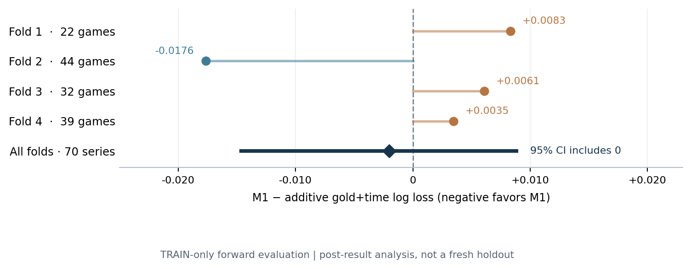

# Live Dota 2 Win Probability

**Truong Quang Sang · Vexil Capital · Senior Data Scientist take-home · 17 November 2026**

**Decision.** Keep the gold-only logistic baseline (M0) as the reference and evaluate the time-aware model (M1) in shadow mode. On 106 held-out games, M1 reduced minute-weighted log loss from **0.5164 to 0.5040** and Brier score from **0.1719 to 0.1684**. Both primary paired 95% confidence intervals include zero. That point-estimate improvement is not enough to promote M1.

**Question.** Does adding game time improve the probability assigned to a given gold lead? I compared four models using a chronological, series-disjoint split, then checked whether M1's gold × time interaction adds anything beyond an additive gold + time model.

## 1. Data and prediction-time validity

The cohort contains **500 professional OpenDota matches**, 250 on each side of a patch change, played **21–26 March 2026**. The original `/proMatches` discovery and frozen IDs are documented in **docs/DISCOVERY_PROVENANCE.md**. Raw historical discovery pages were not archived. This is a narrow five-day sample, not a representative cross-league study.

I split entire series by match start time: **291 TRAIN / 103 VALIDATION / 106 TEST** games, or **10,675 / 3,781 / 3,836** admissible minute forecasts. TRAIN already contains **41 patch-60 games**; VALIDATION and TEST are also patch 60, so this is not a test on an unseen patch.

Each forecast uses economy snapshots through minute *t* and events timestamped at or before 60*t. The strict pre-terminal rule is `60*t < duration`. A future-deletion check found no feature changes across **18,292** snapshots in the original author-controlled raw cache (not bundled). After TEST had first been inspected, I removed **12 exact-terminal rows** (8 TRAIN, 3 VALIDATION, 1 TEST). **The corrected TEST is not a fresh blind holdout.**

Five TRAIN labels were not complete at the first VALIDATION start under a match-end proxy. A sensitivity refit using **286 mature TRAIN games** still selected M1 on the *same* VALIDATION set. All VALIDATION games had ended by the first TEST start on that proxy, with a minimum margin of **143 seconds**. Real event and label receipt timestamps are unavailable.

## 2. Models and selection

I used L2 logistic regression (C=1), fitting imputation and scaling on TRAIN only. The **103 VALIDATION games selected M1** by log loss; neither VALIDATION nor TEST refitted its coefficients.

| Model | Minute-*t* information | VAL log loss | Brier |
| --- | --- | ---: | ---: |
| M0 · Required baseline | Gold lead | 0.5325 | 0.1811 |
| M1 · Time-aware | Gold, minute, gold × log(1 + minute/10) | **0.5197** | **0.1759** |
| M2 · Lead dynamics | M1 + XP and available recent gold/XP changes | 0.5224 | 0.1778 |
| M3 · Objectives | M2 + timestamped towers, barracks, Roshan and kills | 0.5282 | 0.1806 |

The additional XP and objective features did not improve validation loss. I kept M1 rather than carrying their extra complexity forward. The full register of later, non-promoted experiments is in **docs/EXPERIMENT_REGISTER.md**.

---

## 3. Does the interaction earn its complexity?

Figure 1 shows M1's fitted probabilities at fixed gold leads. The curves are displayed only where the original TRAIN data support the corresponding game states. They describe the fitted function, not an effect caused by time.

*Figure 1. M1 scenarios for 0, ±3k and ±6k gold lead. Values outside observed TRAIN support are masked.*

The stronger comparison is **M1 versus additive gold + time without the interaction**. Across four chronological TRAIN-forward blocks (137 evaluation games, 70 series/singletons), M1 improved log loss in only **1/4 folds**. The pooled M1−additive log-loss difference was **−0.0020**, with a 95% grouped interval of **[−0.0148,+0.0090]**. Its pooled Brier difference was **+0.000405 (worse)**, interval **[−0.003059,+0.003857]**. There is **no confirmed incremental benefit** from the interaction. This post-result TRAIN-only check was run after the fitted result was examined; it used TRAIN only, not an additional blind TEST.

*Figure 2. M1 minus additive gold + time log loss; negative favors M1. Pooled interval covers zero.*

The separate TRAIN-only leader-state comparison is descriptive: among games with an absolute 2–4k gold lead, leaders eventually won **66/82** at 10 minutes and **11/25** at 30 minutes, but **only 7 matches occur in both groups**. Different surviving games, not a measured within-game time effect (docs/TRAIN_LEADER_STATE_EMPIRICAL.md).

---

## 4. Held-out forecast quality

I score **each admissible minute forecast**, so longer games receive more weight. The paired intervals resample whole matches (2,000 draws), not individual minutes. The notebook includes model-specific intervals as well as differences.

| Phase (games) | Log loss M0 → M1 | Δ 95% CI | Brier M0 → M1 | Δ 95% CI |
| --- | --- | --- | --- | --- |
| **All (106)** | 0.5164 → **0.5040** | **[−0.0304,+0.0014]** | 0.1719 → **0.1684** | **[−0.0069,+0.0002]** |
| 0–9 (106) | 0.6651 → 0.6506 | [−0.0252,−0.0030] | 0.2362 → 0.2295 | [−0.0117,−0.0014] |
| 10–19 (106) | 0.5695 → 0.5499 | [−0.0343,−0.0031] | 0.1927 → 0.1853 | [−0.0131,−0.0013] |
| 20–29 (105) | 0.4131 → 0.4065 | [−0.0111,−0.0015] | 0.1312 → 0.1293 | [−0.0036,−0.0001] |
| **30+ (79)** | 0.3623 → 0.3555 | [−0.0947,+0.0415] | **0.1028 → 0.1074 (worse)** | [−0.0037,+0.0109] |

A constant TRAIN-win-rate forecast gives TEST log loss **0.6884** and Brier **0.2476**. Both trained models beat it. However, the phase comparisons are exploratory and unadjusted; they do not establish eight separate wins. **At minute 30+, M1's Brier score is about 0.00455 worse.**

*Figure 3. Descriptive phase results from inspected TEST forecasts; minute rows share match outcomes.*

One 55-minute match accounts for **54.9%** of M1's aggregate log-loss gain. Excluding it *for diagnosis*, not model selection, reduces the observed improvement from 0.0124 to 0.0057. A post-hoc series bootstrap still leaves log-loss uncertainty across zero (docs/SERIES_CI_RECEIPT.json). A 100-game November check likewise failed to settle the question: **both intervals contain zero**, removing one league reverses the gain, and **68 games overlap** prior research (docs/FORWARD_100_STRESS.md).

---

## 5. Calibration and deployment decision

On inspected TEST, M1's ECE-10 was **0.0750**, compared with **0.0895** for M0; the grouped difference interval **[−0.0203,+0.0020]** contains zero. In the 30+ phase, ECE worsened from **0.0559 to 0.0680**. M1's average TEST forecast was **0.5429**, versus an observed minute-row win frequency of **0.6045** (63/106 Radiant-winning games). These diagnostics warrant monitoring, not a claim of persistent drift or a TEST-based recalibration.

*Figure 4. Reliability curves from the inspected TEST. Repeated minute rows are not independent games.*

**Recommendation:** Retain M0 as the reference and run M1 in shadow mode. A new promotion decision should use a *precommitted*, multi-league series cohort and require at least **0.005 lower log loss** with clustered uncertainty excluding no gain, alongside no material regression in overall or 30+ Brier. That is a future decision rule, not a threshold retrofitted to these scores.

For an actual live service I would log match/model version, minute, event timestamp, `received_at`, feature watermark and completeness. These historical API records cannot establish packet availability at decision time, and this study does not estimate betting profitability.

## 6. Reproduction and assistance

The deliverable contains **one executed 16-code-cell notebook**: 14 original science cells and two post-TEST audit cells. A pinned **Python 3.12** local replay reproduces the 3,836 TEST forecasts and original figures byte-for-byte from the author-controlled cache (docs/REVIEWER_APPENDIX_FRESH_KERNEL_RECEIPT.json). The earlier 16-cell Colab Run All reproduced metrics to six decimals on its preinstalled stack (docs/COLAB_16CELL_RUN_RECEIPT.json). This revision changes only appendix labels; a new exact-version cloud run has **not** been verified. The notebook's post-inspection appendix is diagnostic and does not create a new blind TEST. Original research commits and branches are retained; PR discussions remain private.

**Time spent:** Approximately **10 hours of active work** (candidate estimate), excluding unattended AI, API and cloud execution.

**Assistance disclosure:** ChatGPT Web generated and revised much of the notebook code, tests and report under my research direction; **Claude Sonnet and Fable AI conducted read-only critiques**. BigLinux/Colab scripts checked numeric outputs; I retained negative results. **Public code:** Standard open-source NumPy, pandas, scikit-learn, Matplotlib and Requests, with versions pinned in requirements.txt. **No third-party Dota predictor was copied. AI reviews are not independent human peer review.**
