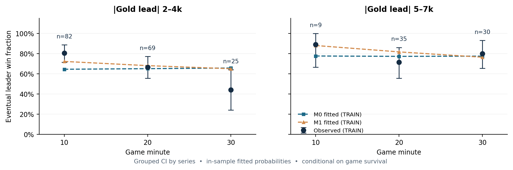
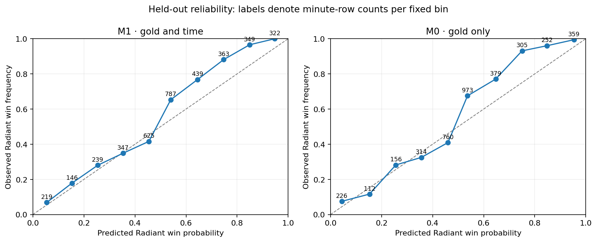

# Live Dota 2 Win Probability

**Truong Quang Sang · Vexil Capital · Senior Data Scientist take-home · 16 November 2026**

**Research question:** Does the same gold lead map to the same win probability at minute 10 and minute 30? I tested that question against the required gold-only baseline **and** a stronger additive gold + time control. The aim was a trustworthy probability, not the best-looking classifier.

**Result:** On 106 TEST games, M1's minute-weighted log loss was **0.5040 vs 0.5164** for M0 (Brier **0.1684 vs 0.1719**). These are point estimates: **both primary paired 95% intervals cross zero**, one game explains **54.9%** of the log-loss gain, and 30+ Brier is **0.00455 worse**. **Decision: M0 remains the reference; M1 is shadow-only.**

## 1. Study design and data integrity

**Why these 500 games:** Original 13 Nov collection paged `/proMatches` to an observed patch boundary near page 93 and fetched **250 eligible games per patch** from `/matches/{match_id}`. The ordered IDs were frozen in commit **3258a762** before held-out scoring. Today `Run all` refetches those same IDs, **not** the moving `/proMatches` feed; the original selection code and dated evidence are in **docs/DISCOVERY_PROVENANCE.md**. These March **21–26, 2026** games span only **5.26 days** and are not a representative sample of all leagues or future patches. Raw historical discovery pages were not archived.

The **18,292 minute-level rows are forecast opportunities, not independent outcomes**. At minute *t*, features use economy indices ≤*t* and events timestamped ≤`60*t`; winner, final totals and duration never enter the predictors. An **author-cache** future-deletion audit found zero differences across **all 18,292** feature snapshots (raw payloads not bundled). I imposed the **strict pre-terminal** condition `60*t < duration` and removed 12 exact-end rows (8 TRAIN, 3 VALIDATION, 1 TEST) **after the original TEST was opened**. The repaired scores are **not a second blind evaluation** of the TEST.

I split by start time, keeping entire series together: **291 TRAIN / 103 VALIDATION / 106 TEST** games (**10,675 / 3,781 / 3,836** minute rows). TRAIN includes 41 patch-60 games; VAL/TEST are both patch 60, **not an unseen-patch test**. At first VAL start, five TRAIN labels had not matured by an end-time proxy. Excluding them and refitting on **286 mature TRAIN games** still favored M1 on **reused VAL** (log loss **0.5202 vs 0.5329**). At TEST start, 0/103 VAL games remained unfinished, but the minimum proxy margin was just **143 seconds**. Actual live received-at timing remains unknown.

## 2. Model design and validation selection

I fixed four interpretable candidates before TEST and trained each (including imputation/scaling) on **291 TRAIN games only**, using L2 logistic regression with fixed C=1. The **103 VAL games selected M1**. Neither VAL nor TEST refit its coefficients. Without a draft/team prior, M1 has little early signal: **101/106** minute-zero TEST forecasts sit between 45% and 55%.

| Model | Minute-*t* inputs | Validation log loss | Brier |
| --- | --- | ---: | ---: |
| **M0 · Required baseline** | Gold difference | 0.5325 | 0.1811 |
| **M1 · Time value** | Gold, minute, gold × log(1 + minute/10) | **0.5197** | **0.1759** |
| M2 · Lead fragility | M1 + XP + available ≤5-minute gold/XP change | 0.5224 | 0.1778 |
| M3 · Objective conversion | M2 + timestamped towers, barracks, Roshan, kills | 0.5282 | 0.1806 |

M1 models a time-dependent mapping from a fixed gold lead to win probability. That is **not** a claim that gold becomes less discriminative late in a match. M2 and M3 added plausible state information but scored worse on validation; I kept the simpler M1 **for this sample**.

---

## 3. What the model actually learned

**An economic lead has context.** At fixed **+2,000 Radiant gold**, M1 predicts **66.5%** at 10m versus **59.4%** at 30m. The **+7.1 pp** post-selection TRAIN-only bootstrap contrast has 95% interval **[−1.1,+13.8] pp**, crossing zero (2,000 refits; 149 series plus 22 singletons). This is not a causal effect or a confirmed incremental interaction. The separate TRAIN counts **60/291** (10m) and **87/214** (30m) include **all Radiant leads ≥2k**, *not* observations near exactly +2k; Figure 1 masks poorly supported conditions.

*Figure 1. Conditional M1 curves at 0, ±3k and ±6k gold. The +2k contrast and bootstrap bands are not plotted. Not causal.*

**What the games actually show (TRAIN only).** With an absolute gold lead of **2–4k**, the leading team ultimately won **66/82 (80.5%)** at 10m and **11/25 (44.0%)** at 30m; series-bootstrap 95% descriptive intervals were **[71.4%,88.8%]** and **[24.0%,64.0%]**. At **5–7k**, the pattern was not monotone, and minute-10 had only **9 games**. These are **different surviving game samples**, not a causal time effect or evidence M1 predicts better; the dashed M0/M1 probabilities are fitted *in-sample* on TRAIN (docs/TRAIN_LEADER_STATE_EMPIRICAL.md).

*Figure 2. Fixed TRAIN-only 3k/6k lead neighborhoods (±1k), each game counted once per cell; unadjusted series-resampled uncertainty. Not causal or out-of-sample.*

## 4. What did not survive model selection

**The stronger null is the real check.** Against **gold + time without interaction**, M1's TRAIN-forward log-loss difference was **−0.0020**, 70-series 95% interval **[−0.0148,+0.0090]**; it won only **1/4** chronological folds (deltas **+0.0083, −0.0176, +0.0061, +0.0035**). The fitted **+2k gold log-odds contrast (10m−30m)** was **+0.301** in 250 patch-59 TRAIN games versus **+0.029** in only 41 patch-60 games: an unstable, post-hoc subgroup comparison, not proven drift. Of **at least 38** historical checks, **0/28** follow-ups cleared promotion gates on **reused validation**. The promising item model (P20) had VAL loss **0.5145 vs 0.5197**, but **1/3 pre-correction TRAIN** folds favored it; its **pre-correction, 28-way adjusted** interval **[−0.0169,+0.0064]** crossed zero. No new model was promoted (docs/EXPERIMENT_REGISTER.md).

---

## 5. Held-out forecast quality and uncertainty

The target is proper loss **per admissible minute-level forecast opportunity**, weighting longer games more. The notebook gives **model-specific** and paired M1−M0 95% CIs for each phase/metric, based on **whole-match** resampling (2,000 draws), never independent minute rows. Post-hoc series resampling changes CI widths without resolving overlapping-team/league dependence; the table below shows the paired differences.

| Phase (games) | Log loss M0 → M1 | Difference 95% CI | Brier M0 → M1 | Difference 95% CI |
| --- | --- | --- | --- | --- |
| **All (106)** | 0.5164 → **0.5040** | **[−0.0304,+0.0014]** | 0.1719 → **0.1684** | **[−0.0069,+0.0002]** |
| 0–9 (106) | 0.6651 → 0.6506 | [−0.0252,−0.0030] | 0.2362 → 0.2295 | [−0.0117,−0.0014] |
| 10–19 (106) | 0.5695 → 0.5499 | [−0.0343,−0.0031] | 0.1927 → 0.1853 | [−0.0131,−0.0013] |
| 20–29 (105) | 0.4131 → 0.4065 | [−0.0111,−0.0015] | 0.1312 → 0.1293 | [−0.0036,−0.0001] |
| **30+ (79)** | 0.3623 → 0.3555 | [−0.0947,+0.0415] | **0.1028 → 0.1074 (worse)** | [−0.0037,+0.0109] |

**No-skill scale:** A constant probability equal to the TRAIN game-win rate (149/291 = 0.5120) gives TEST log loss **0.6884** and Brier **0.2476** on these same 3,836 minute forecasts. Both fitted models beat that reference, although M1's gain over M0 remains uncertain.

The 0–29 phase differences nominally favor M1, but **eight phase × metric comparisons are unadjusted**, so they are **exploratory**, not eight confirmed wins. The 30+ subset retains only longer games: Brier is **about 0.00455 worse** for M1, 95% interval **[−0.0037,+0.0109]**. November's 100-game check **did not replicate a material 0–9 Brier improvement** (**0.24421→0.24393**) and its ECE worsened (**0.0496→0.0812**); it overlaps prior research and is not independent confirmation. Equal-match-weighted TEST log loss was **0.5097→0.4952**, without a grouped CI. Original TEST-CI notebook wording 'Pre-registered' refers to the specified **resampling method**, not to the corrected post-inspection TEST values.

*Figure 3. Descriptive phase Brier/ECE on the original TEST. Rows from one game share a label; bars are not independent uncertainty estimates.*

**Stress tests did not settle the decision.** On **100 already completed** November 11–15 games (4,355 minutes, **56 series/singletons**, **85 games** from two leagues), M1−M0 log loss was **−0.0080**, CI **[−0.0284,+0.0087]**; Brier CI **[−0.0077,+0.0027]**; both contain zero. **Omitting one league reverses the gain**; **68 games overlap** earlier research. Patch 60 is not unseen. This is **not independent confirmation** (docs/FORWARD_100_STRESS.md).

The post-hoc **54-series** resample put log-loss CI at **[−0.0283,+0.0001]** and Brier CI at **[−0.0067,−0.0004]**; match-bootstrap Brier still reaches **+0.0002**. Results sit near the decision boundary. A single 55-row game explains **54.9%** of observed log-loss gain; excluding it for diagnosis cuts the gain from **0.0124 to 0.0057** and flips remaining 30+ log-loss difference to **+0.0314 (M1 worse)**. The official TEST and scores keep that game.

---

## 6. Calibration is a separate release risk

M1 predicts **0.5174** on used **VALIDATION** versus **0.4874** winners; on inspected **TEST** (63/106 game winners), **0.5429** versus **0.6045**. Forecast-minus-outcome bias is **+0.0300** (post-hoc **53-series** CI **[−0.0436,+0.1001]**) versus **−0.0617** (**54-series** CI **[−0.1410,+0.0250]**). Neither interval proves drift; M0 has similar bias. TEST ECE10 is **0.0895 (M0)** versus **0.0750 (M1)**, difference CI **[−0.0203,+0.0020]**; late-30+ ECE worsens **0.0559 → 0.0680**. A TRAIN-only offset improved reused VAL log loss **0.5197→0.5186**, but worsened ECE10 **0.0492→0.0561**: **HOLD**. Fixed-bin grouped uncertainty remains post-hoc (docs/CALIBRATION_FIXED_BIN_GROUPED_CI.md). **No TEST recalibration** (docs/CALIBRATION_BIAS_READOUT.md).

*Figure 4. Calibration diagnostic from already inspected TEST, not a tuning target.*

## 7. Decision I would make in production

**Keep M0 as the reference; run M1 in shadow mode.** M1's aggregate TEST and November point scores are favorable, but **neither paired confidence interval establishes superiority**. League dependence, late-game Brier instability and unknown feed-arrival timing remain. I would size and preregister a fresh multi-league series cohort before a new decision. A future promotion gate is at least **0.005 lower log loss**, supported by clustered uncertainty and no material overall or 30+ Brier regression; this is **not** a retrospective significance threshold.

A real feed would need the match/model version, minute, **event time, received-at time, feature watermark and completeness**. The archived API cannot certify live data arrival or profitable betting without executable odds, fills and costs.

## 8. Reproducibility and assistance

Original research commits and branches are retained; model **e49e853** and cohort **3258a762** predate TEST; PR discussions remain private (**no reviewer access granted**). Two post-TEST appendix cells audit **all 18,292 PIT snapshots** without changing the frozen science. Local **Python 3.12 pinned** replay reproduced **3,836 TEST predictions and three original figures byte-for-byte** (docs/REVIEWER_APPENDIX_FRESH_KERNEL_RECEIPT.json). A separate **16-cell Colab CPU Run All** completed **16/16** cells, 500 games/510 calls, zero errors, and six-decimal score parity. **Colab retained preinstalled Python 3.13 / NumPy 2.4.6 / scikit-learn 1.6.1**, unlike local NumPy 2.2.6 / scikit-learn 1.7.2. Notebook outputs are cached-local, not the fresh cloud run; **cloud CSV byte parity remains unverified** (docs/COLAB_16CELL_RUN_RECEIPT.json).

**Time spent:** Approximately **10 hours of active work** (candidate estimate), excluding unattended AI, API and cloud execution.

**Assistance disclosure:** ChatGPT Web generated and revised much of the notebook code, tests and report under my research direction; **Claude Sonnet and Fable AI conducted read-only critiques**. BigLinux/Colab scripts checked numeric outputs; I retained negative results. **Public code:** Standard open-source NumPy, pandas, scikit-learn, Matplotlib and Requests, with versions pinned in requirements.txt. **No third-party Dota predictor was copied. AI reviews are not independent human peer review.**
