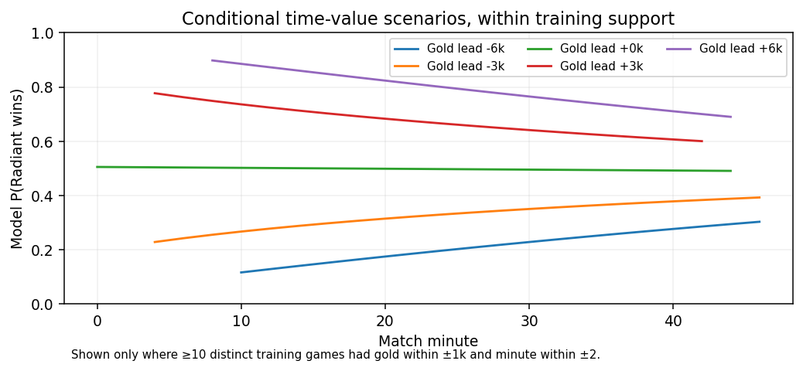
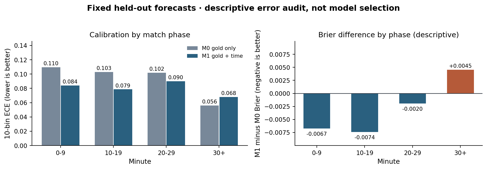

# Live Dota 2 Win Probability

**Truong Quang Sang · Vexil Capital · Senior Data Scientist take-home · 19 November 2026**

**Decision.** M1 is the validation-selected challenger. On the required 500-game study it lowered TEST log loss **0.5164 to 0.5040** and Brier **0.1719 to 0.1684**, but both match-paired intervals include zero and late-game Brier worsened. A separate, prescored 199-game September evaluation favors M1 more strongly, albeit across only three leagues. I would retain M0 as the baseline and prioritize M1 for live-timestamped shadow evaluation, not make a production claim.

**Question.** Does adding game time improve the probability assigned to a given gold lead? I compared four models with a chronological, series-disjoint split and tested the interaction against a simpler additive gold + time model.

## 1. Data and prediction-time validity

The cohort contains **500 professional OpenDota matches**, 250 on each side of a patch change, played **21–26 March 2026**. The original `/proMatches` discovery and frozen IDs are documented in **docs/DISCOVERY_PROVENANCE.md**. Raw historical discovery pages were not archived. This is a narrow five-day sample, not a representative cross-league study.

I split entire series by match start time: **291 TRAIN / 103 VALIDATION / 106 TEST** games, or **10,675 / 3,781 / 3,836** admissible minute forecasts. TRAIN already contains **41 patch-60 games**; VALIDATION and TEST are also patch 60, so this is not a test on an unseen patch.

Each forecast uses economy snapshots through minute *t* and events timestamped at or before 60*t. The strict pre-terminal rule is `60*t < duration`. A future-deletion check found no feature changes across **18,292** snapshots in the original author-controlled raw cache (not bundled). After TEST had first been inspected, I removed **12 exact-terminal rows** (8 TRAIN, 3 VALIDATION, 1 TEST). **The corrected TEST is not a fresh blind holdout.**

Five TRAIN outcomes were unfinished at the first VALIDATION start under a game-end proxy. Refitting on **286 mature TRAIN games** still selected M1. A hypothetical 60-minute result delay changes a reused-VAL M1/M2 ranking by only **0.000268** after excluding seven later-finishing games; no model was changed. Neither proxy measures real feed arrival (docs/REVIEWER_SCIENTIFIC_LIMITS.md).

## 2. Models and selection

I used L2 logistic regression (C=1), fitting imputation and scaling on TRAIN only. The **103 VALIDATION games selected M1** by log loss. The terminal-row correction required refitting on TRAIN after initial TEST inspection. The corrected comparison remains retrospective.

| Model | Minute-*t* information | VAL log loss | Brier |
| --- | --- | ---: | ---: |
| M0 · Required baseline | Gold lead | 0.5325 | 0.1811 |
| M1 · Time-aware | Gold, minute, gold × log(1 + minute/10) | **0.5197** | **0.1759** |
| M2 · Lead dynamics | M1 + XP and available recent gold/XP changes | 0.5224 | 0.1778 |
| M3 · Objectives | M2 + timestamped towers, barracks, Roshan and kills | 0.5282 | 0.1806 |

XP and objective features added complexity without lowering validation loss, so I kept M1. The full register of later, non-promoted experiments is in **docs/EXPERIMENT_REGISTER.md**.

**Further models (after TEST inspection):** On chronological TRAIN-forward folds, a five-input gold-path logistic model Q1 scored **0.6060** versus M1 **0.6121**, but its series CI for the difference **[-0.0174,+0.0047]** includes zero. Three-input XGBoost and LightGBM scored **0.6156** and **0.6162**. Wider-feature and delay studies are exploratory; several used a Roshan parser later corrected on TRAIN only (docs/CREATIVE_FEATURE_EXPERIMENT_ATLAS.md).

---

## 3. Does the interaction earn its complexity?

Figure 1 shows M1's fitted probabilities at fixed gold leads. The curves are displayed only where the original TRAIN data support the corresponding game states. They describe the fitted function, not an effect caused by time.

*Figure 1. M1 scenarios for 0, ±3k and ±6k gold lead. Values outside observed TRAIN support are masked.*

The stronger March comparator is **additive gold + time without interaction**. M1 helped in only **1/4 TRAIN-forward folds** (137 games); pooled difference **−0.0020** log loss, grouped 95% CI **[−0.0148,+0.0090]**, Brier difference **+0.000405 (worse)**. This is inconclusive *within March TRAIN*. A separate September external M0-versus-M1 evaluation was locked before scoring and favored M1. A September **post-hoc** additive comparison also favored the interaction (−0.04135, CI [−0.07626,−0.01224]); it is exploratory, with only three leagues and repeated teams.

*Figure 2. M1 minus additive gold + time log loss; negative favors M1. Pooled interval covers zero.*

In a separate TRAIN-only comparison of 2–4k gold leads, the leading side eventually won **66/82** games at minute 10 and **11/25** at minute 30. Only **7 games** were in both groups, so this is not evidence of a within-game time effect (docs/TRAIN_LEADER_STATE_EMPIRICAL.md).

### Additional feature and model experiments (full inventory: `docs/CREATIVE_FEATURE_EXPERIMENT_ATLAS.md`)

**28 adaptive screens:** I tested time-shape, team-economy allocation, gold shocks, towers, Roshan/Aegis, buyback, Blink/BKB item completion and hero draft. Best historical *reused-VAL* point estimate was **P20** (LL **0.514098** vs old M1 **0.519346**), but the adjusted 28-way interval includes zero; **0/28 promoted**.

**81 engineered features:** 19 gold dynamics, 13 XP, 19 player allocation, 17 objectives and 13 interactions. The original parser missed Roshan team attribution; one other feature was duplicated. After repairing Roshan, the fixed 84-input Q2 (elastic-net logistic) and Q3 (shallow boosted tree) models still had worse TRAIN-forward log loss than M1 (**+0.0177** and **+0.0101**). Neither was promoted; the original TEST was not used for the repair.

---

## 4. Held-out forecast quality

I score **each admissible minute forecast**, so longer games receive more weight. The paired intervals resample whole matches (2,000 draws), not individual minutes. The notebook includes intervals for each model and their differences. Every Δ interval below is M1−M0; negative favours M1.

| Phase (games) | Log loss M0 → M1 | Δ 95% CI | Brier M0 → M1 | Δ 95% CI |
| --- | --- | --- | --- | --- |
| **All (106)** | 0.5164 → **0.5040** | **[−0.0304,+0.0014]** | 0.1719 → **0.1684** | **[−0.0069,+0.0002]** |
| 0–9 (106) | 0.6651 → 0.6506 | [−0.0252,−0.0030] | 0.2362 → 0.2295 | [−0.0117,−0.0014] |
| 10–19 (106) | 0.5695 → 0.5499 | [−0.0343,−0.0031] | 0.1927 → 0.1853 | [−0.0131,−0.0013] |
| 20–29 (105) | 0.4131 → 0.4065 | [−0.0111,−0.0015] | 0.1312 → 0.1293 | [−0.0036,−0.0001] |
| **30+ (79)** | 0.3623 → 0.3555 | [−0.0947,+0.0415] | **0.1028 → 0.1074 (worse)** | [−0.0037,+0.0109] |

The constant TRAIN-win-rate forecast has TEST log loss **0.6884** and Brier **0.2476**. Six of eight phase intervals favour M1 but overlap in games and are unadjusted. TEST minute-30+ Brier worsens **+0.00455**. Across 137 TRAIN-forward games, M1's log-loss edge was only **0.000226** and its overall Brier was worse (**0.212744 vs 0.211828**); its TRAIN-forward late30 Brier favored M1 instead. These are different model fits and time slices, not a clean drift estimate.

*Figure 3. Descriptive phase results from inspected TEST forecasts; minute rows share match outcomes.*

One 55-minute TEST match provides **54.9%** of M1's aggregate log-loss gain. Deleting it *for influence diagnosis only* cuts the overall difference from **−0.0124 to −0.0057**; minute-30+ M1−M0 log loss switches **−0.00678 to +0.03139** and Brier worsens **+0.00455 to +0.00748**. No model was refitted (docs/ERROR_AUDIT_RECEIPT.json).

The primary whole-match intervals for both scores include zero. Post-hoc 54-series bootstrap: log-loss CI **[−0.02828,+0.00012]** still crosses zero; Brier CI **[−0.00670,−0.00038]** narrowly excludes it. Shared teams/leagues remain. A November 100-game check is inconclusive; **68 games overlap** an earlier cohort (docs/SERIES_CI_RECEIPT.json; docs/FORWARD_100_STRESS.md).

**Other time cohorts, evaluated outside the required 500 games:** See docs/CROSS_COHORT_EVIDENCE.md for complete cohort selection and overlap details.

| Period (study) | Games | M0 log loss | M1 log loss | Evidence boundary |
| --- | ---: | ---: | ---: | --- |
| March original TEST | 106 | 0.5164 | **0.5040** | Match CI crosses zero |
| 30 Mar–2 Apr stage | 200 | 0.5451 | **0.5337** | Phase blend failed; retrospective |
| September locked external | 199 | 0.5844 | **0.5448** | 95% series CI [−0.0743,−0.0108] |
| October transfer | 180 | 0.4995 | **0.4936** | Outcomes reused in model search |
| November later | 100 | 0.5411 | **0.5331** | CI crosses zero; 68 overlaps |

---

## 5. Calibration and recommendation

On inspected TEST, ECE-10 was **0.0750** for M1 versus **0.0895** for M0 (grouped difference CI **[−0.0203,+0.0020]**, includes zero). At minute 30+, ECE worsened **0.0559 to 0.0680**. M1's mean forecast was **0.5429**, versus observed win rates **0.6045** minute-weighted and **63/106 = 0.5943** game-weighted. No TEST recalibration.

*Figure 4. Reliability curves from the inspected TEST. Repeated minute rows are not independent games.*

**Recommendation:** M1 merits priority for shadow testing, while M0 stays the required baseline. September **passed its predeclared limited-support gate**, but its three leagues and heavily shared teams, influential games and unmeasured packet arrival prevent a general production claim. I would request new, diverse league-level evidence, verified `received_at` and no late-game Brier regression before enabling live decisions.

For an actual live service I would log match/model version, minute, event timestamp, `received_at`, feature watermark and completeness. These historical API records cannot establish packet availability at decision time, and this study does not estimate betting profitability.

## 6. Reproduction and assistance

**Reproduction:** The 16-cell notebook covers the original 500 games and two post-TEST QA cells. A fresh **19 November Colab CPU Run All** completed **16/16 cells**, fetched 500 games and matched aggregate TEST scores to six decimals over **3,836 rows**; per-forecast cloud equality was **not** checked (docs/COLAB_EXACT_SHIPPED_NOTEBOOK_RECEIPT.json). The original March TEST remains previously inspected.

**Time spent:** **10 active human hours**, confirmed by the applicant; unattended agent, API and cloud runs excluded.

**Assistance disclosure:** I reviewed the evidence and take responsibility for the modelling choices and final conclusions. ChatGPT Web drafted and revised much of the notebook, tests and report. Claude Sonnet/Fable provided read-only critiques; remote agents ran much of the post-TEST experimentation and verification. AI reviews are not independent human peer review. The notebook uses NumPy, pandas, SciPy, scikit-learn, Matplotlib, Requests, tqdm and Jupyter (pinned in requirements.txt); supplementary research used XGBoost 3.4.1, LightGBM 4.7.0 and Narwhals 2.21.2.
