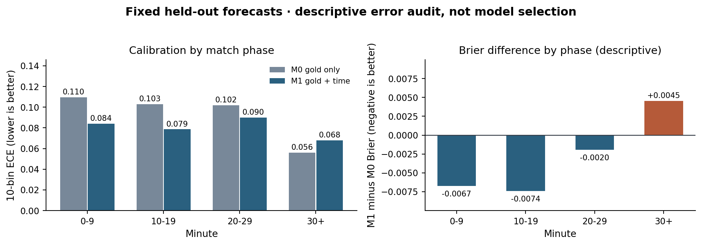

# Error analysis: why M1 remains a challenger

**Evidence class: post-hoc diagnostics on an already inspected TEST cohort.**
M1 was chosen using VALIDATION before the first TEST inspection. The later correction of 12 terminal rows required refitting the same model specification on corrected TRAIN; consequently, the reported TEST is no longer blind. These diagnostics perform no fitting and prompted no additional model choice or recalibration.

The corrected Vexil submission is one executable notebook plus the four-page REPORT.pdf. This additional document makes the *failure cases* independently inspectable. For the full search history, including negative results, see [EXPERIMENT_REGISTER.md](EXPERIMENT_REGISTER.md).

## Strict pre-terminal source boundary

The original notebook included 12 rows exactly at match end where duration was divisible by 60 (8 TRAIN, 3 VALIDATION, 1 TEST). The corrected notebook and item-feature loop both require 60*t < duration. It was refitted and executed in full on the same frozen 500-game cache (zero new HTTP calls; 14/14 code cells). The frozen corrected dataset has 18,292 minute rows and 3,836 TEST predictions. Earlier Kaggle/Colab cold runs covered the prior inclusive-endpoint code, not this exact correction.

## Does the gold-by-time effect help consistently?

| TEST phase | Matches / minute rows | Δ log loss, M1−M0 | Δ Brier, M1−M0 | ECE M0 → M1 |
|---|---|---:|---:|---:|
| 0–9 | 106 / 1,060 | −0.01451 | −0.00672 | 0.1097 → 0.0840 |
| 10–19 | 106 / 1,060 | −0.01960 | −0.00741 | 0.1028 → 0.0786 |
| 20–29 | 105 / 997 | −0.00667 | −0.00195 | 0.1019 → 0.0901 |
| **30+** | **79 / 719** | −0.00678 | **+0.00455, worse** | **0.0559 → 0.0680, worse** |

All values are descriptive point estimates from the fixed test forecasts. ECE uses ten equal-width bins over repeated within-game labels. The original 30+ **Brier point difference** is +0.00455, but its paired 95% interval **[−0.0037,+0.0109] includes zero**, so the phase reversal is not confirmed. A later 200-game development cohort favors M1 on aggregate point scores; it does not identify the 30+ effect. The original report's paired log-loss/Brier intervals remain the primary inferential evidence.

*Figure: Descriptive phase ECE and Brier-score differences; the observed late-game reversal is inconclusive and was not used for model selection.*

## Series-dependence sensitivity (post-hoc, not a second TEST)

The 106 TEST games belong to **54 professional series**. I re-fetched only their series ID metadata from the permitted OpenDota match endpoint and froze the [106-game grouping](SERIES_GROUPS_TEST.json). With the unchanged 3,836 forecasts, a **10,000-draw paired cluster bootstrap by whole series** (seed 20261115) estimates the M1−M0 log-loss difference 95% CI **[−0.02828, +0.00012]**. It still includes zero. The series-bootstrap Brier difference CI is **[−0.00670, −0.00038]**, unlike the prespecified match-cluster primary interval, which includes zero. Neither result is an independent evaluation, and no model was refit or promoted.

The unit is the series: resample series IDs with replacement, sum all per-minute loss differences within sampled series and divide by the sampled minute-row count. The [offline series-bootstrap script](../research/series_cluster_sensitivity.py) reproduces the frozen [series-sensitivity receipt](SERIES_CI_RECEIPT.json) without OpenDota requests. Series-grouping metadata was obtained only after TEST for uncertainty diagnosis, never used as a model feature.

## Is the global improvement driven by a few matches?

The corrected TEST contains **106 games and 3,836 forecast opportunities**. M1–M0 mean log-loss difference is **−0.012430**. Match **8744971178** contains 55 minute rows and contributes **54.92% of the total signed log-loss improvement**. If this match is removed for influence diagnosis, the remaining 105 games have mean M1−M0 difference **−0.005685**: the sign survives, but the gain is materially smaller.

Late-game M1 Brier has a worse **point estimate** even though its log-loss point estimate improves slightly; neither establishes a late-game population ranking. Excluding that influential match's 25 late-minute rows reverses the remaining **719 to 694** late-phase forecast log-loss delta from **−0.00678 to +0.03139** (M1 worse); Brier delta also worsens from **+0.00455 to +0.00748**. Both figures are computed directly from the frozen CSV and written into ERROR_AUDIT_RECEIPT.json, with a deterministic source-level regression test. This is not a new primary metric or a license to delete inconvenient games.

The 55-minute game's influence matters because longer matches contribute more forecast rows. The leave-one-out calculation is diagnostic rather than a new confidence interval; series and team dependence remain.

## Check the base rate before interpreting calibration

The saved 500-game notebook reports Radiant winning **51.2% of 291 TRAIN games**, **48.5% of 103 VALIDATION games** and **59.4% of 106 TEST games**. The TEST row-weighted observed win fraction is **60.45%**, versus mean predicted probabilities of **54.24% (M0)** and **54.29% (M1)**. Both models underpredict this held-out cohort on average. With few games in a narrow March patch window, these differences do not identify whether the cause is genuine patch/league drift or sampling variation; no TEST recalibration is performed.

## What else could make the result fail in deployment?

The 500 selected games span **5.26 days** across one patch boundary (250 patch 59, 250 patch 60). Validation and TEST are entirely patch 60; the study does not establish unseen-patch performance. TRAIN/VALIDATION/TEST Radiant game-win fractions are **51.2% / 48.5% / 59.4%**. On TEST M1 predicts an average Radiant win probability of **0.5429**, versus an actual row-weighted win share **0.6045**. Such misalignment may combine model error, side prevalence variation, league/team composition and sampling noise. This small cohort does not separate those mechanisms.

The OpenDota endpoint returns a *parsed, completed match*. Its event time is retrospective game time, **not** the timestamp when a live consumer actually received an event. The forecast code demonstrates correctness under the brief's event-time cutoff; reliable production scoring would additionally need a received-at clock, input watermark, feature-staleness controls, label maturity and future-state replay assertions.

## Deployment decision

**Retain M0 as the reference, shadow-test M1** and log source version, event/arrival times and phase-specific proper scores. For further research, predeclare **one** mechanistic gold-history or objective-state hypothesis, check its actual time availability, compare it with a simpler alternative and evaluate on a fresh series/tournament cohort. Require stable aggregate and late-game calibration and uncertainty before model promotion. A lower development loss after screening many feature ideas is not proof of a reliable new model.

### Reproduction (no API, no model fitting)

From repository root, using the pinned Python 3.12 environment:

    python research/error_diagnostics.py --check --json docs/ERROR_AUDIT_RECEIPT.json

This standard-library script reads only the included **artifacts/heldout_predictions.csv**, checks the frozen SHA-256, recomputes the original log loss, Brier, 10-bin ECE, phase scores and match influence, and fails if the numerical contract changes. The separate optional chart renderer uses the pinned scientific environment:

    python research/render_error_figure.py

The receipt and figure are committed as review artifacts. They are **not inputs** to the submission notebook. The corrected 3,836 forecasts were frozen after the pre-terminal source repair and were not used to select a new model.
