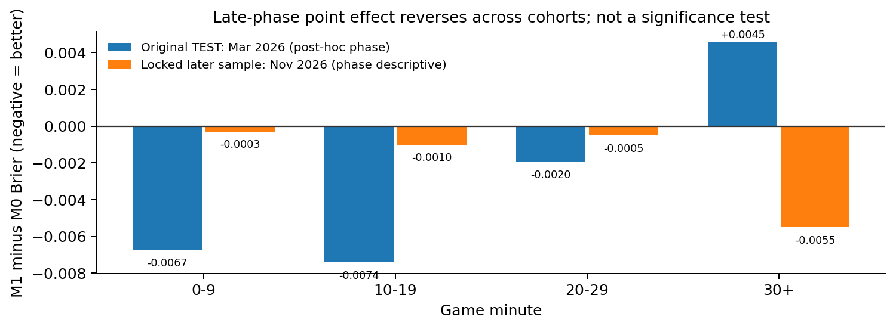

# Later-match frozen-model stress test (optional evidence)

This is supplementary evidence, **not** part of the 500-match model-selection
test required by Vexil. The original held-out TEST had already been inspected.
The newer professional matches were **played before** this follow-up
selection protocol was committed. The procedure was frozen before this
particular API detail retrieval, **not before all previous looks**:
68/100 outcomes were available in an earlier November research run.
This is not a prospective or independently blind future-event study.

## Sampling and model provenance

On 15 November 2026, an author-controlled protocol was committed
(9d6cddf); the 15-page candidate listing was then frozen (1,073 IDs)
and the first 100 eligible match details were selected in descending
match-ID order. **100 of 101** details met the original parsed,
at-least-10-minute, strict minute-clock rule (one had no gold history).
The matches were played **11–15 November 2026**, and cover 4,355
pre-terminal minute opportunities, **56 professional series/singleton
clusters, just four leagues (85% of games in two leagues)** and
OpenDota-reported patch ID **60**. A single API patch ID does not
resolve letter-level balance changes over eight months. This is not
a confirmed unseen-*major*-patch or representative multi-league test.

M0 and M1 were fitted **only on the original 291 TRAIN games** using
the frozen source, no new features, tuning or calibration. An offline
source-lineage check reconstructed the original 10,675 TRAIN rows
from the original 500 raw payloads and reproduced all **3,836 original
TEST probabilities** (maximum absolute M1 difference
1.85e-13), without choosing any new model. The new 100-game outcomes
were used for scoring only.

## Scores on the 100 newer games

| Metric (lower is better) | Original M0 gold-only | Original M1 gold and time |
| --- | ---: | ---: |
| Minute-row log loss | 0.5411 | **0.5331** |
| Minute-row Brier | 0.1853 | **0.1831** |
| 10-bin ECE, descriptive only | 0.0520 | 0.0500 |

M1-minus-M0 log loss was **-0.0080**, 95% paired grouped bootstrap
(5,000 draws across 56 series-or-singletons) **[-0.0284,+0.0087]**.
Brier difference was **-0.0022**, interval **[-0.0077,+0.0027]**.
**Both intervals include zero.** The observed Radiant winner fraction
was 0.4466 across forecast rows, while the two mean predictions
were 0.4674 and 0.4713.

Although overall ECE points slightly favor M1, **early 0–9-minute
ECE deteriorated** from 0.0496 (M0) to 0.0812 (M1). ECE has no
registered uncertainty interval and cannot establish calibration
superiority. No recalibration was performed.

*Figure. The original TEST 30+ Brier point estimate favored M0;
the newer 100-game point estimate favored M1. Neither is a confirmed
phase-specific population effect.*

## Sensitivity and decision

The newer sample is highly concentrated in four leagues. Its
aggregate M1 log-loss advantage mainly comes from league 20511
(42 games, delta -0.0292); in league 20486 (43 games), M1 was
worse (delta +0.0094). Excluding league 20511 **for diagnosis only**
would reverse the overall delta to +0.00736, so league-level
dependence and sample composition dominate the interpretation.
**All 100 matches remain in the official scores**.

**HOLD.** M0 remains the production reference, M1 shadow-only.
A 100-game slice from four leagues is not enough to conclude
improved generalization; it cannot measure real received-at
timestamps, execution odds or betting profitability.

## Overlap with earlier November research

An earlier **120-game November 9–13 cohort** used a different
selection protocol, yielding 5,100 minute rows and 61
series/singletons. Its frozen game-ID manifest is bundled as
docs/NOVEMBER_120_RESEARCH_MANIFEST.csv; the source branch remains
part of the curated repository history, but access is not needed
to audit the 68 shared match IDs. Its frozen M1−M0 log-loss difference was
**−0.01886**, with 95% grouped interval **[−0.04872,+0.00379]**:
also inconclusive. The current 100-game scan was performed afterward
as a separate later-calendar-time stress check, not a confirmation of
the prior result. Comparing its
frozen 120-match manifest with this later 100-game cohort shows
**68 common game IDs**, **32 unique to this 100-game study**, and
**52 unique to the archived 120-game study**.

These are **not two independent temporal replications**. I report
both results separately rather than pooling scores or choosing the
more favorable one. Both analyses
retain their original estimates and limitations. The earlier
120-game manuscript is not being silently merged or reinterpreted
as an independent replication of this 100-game cohort.

The complete original 120-ID manifest, the 100-to-120 overlap IDs,
an SHA-pinned result receipt and a standalone Python verifier are
bundled as docs/NOVEMBER_120_RESEARCH_MANIFEST.csv,
docs/NOVEMBER_COHORT_OVERLAP_RECEIPT.json and
scripts/verify_november_cohort_overlap.py. This is a
**post-hoc disclosure**, not a new performance experiment.

## Verifiability and boundaries

**Offline reviewer verification:** With the repository's pinned Python
dependencies installed, run python scripts/verify_forward_100.py.
It recalculates all 4,355 forecasts' log loss, Brier, phase ECE,
5,000-resample grouped confidence intervals and league sensitivities
from bundled CSVs without the raw JSON cache, without OpenDota and
without re-fitting any model.

The accompanying FORWARD_100_EVIDENCE.json includes the original
accepted-game IDs and source hashes, all scores, grouping metadata,
league diagnostics, Python/environment parity, and an operator-
controlled timing audit. FORWARD_100_CANDIDATES.json preserves the
1,073-ID selection order, and artifacts/forward_100_predictions.csv
contains **all 4,355 probabilities and final outcomes**. Its
companion artifacts/forward_100_metadata.csv carries match-minute
boundaries, series, team and league identities for independent audit.
The original protocol and its later, explicitly dated clarification
are included separately and were not rewritten to hide the
pre-existing-match limitation.

All six locally injected data/selection/score mutations were rejected.
An author-controlled no-network replay from cached raw JSON matched
the full 4,355-row forecast CSV byte-for-byte. **Those raw OpenDota
payloads are not in this ZIP** and can change if re-fetched. These
receipts are reproducibility evidence, not external notarization
or a human peer review. This supplement does not change the
500-game assessment, original forecasts or model selection.
