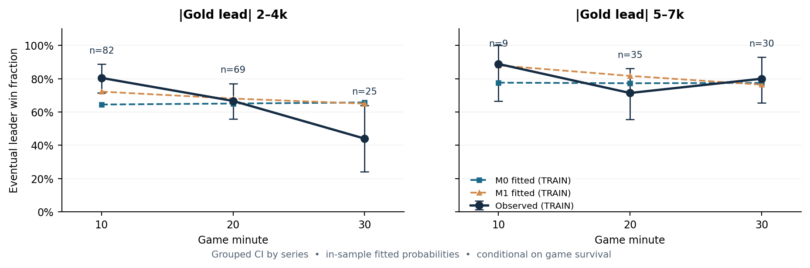

# When a gold lead is not a guarantee: six original TRAIN-only cells

**Scope:** post-hoc, descriptive, **not** a second validation, blind TEST, causal study or model-selection gate. This study was added after Fable's hostile review questioned whether the time-by-gold interaction had data-grounded meaning. The six analysis cells are fixed in the [reproduction script](../research/train_leader_state_empirical.py) before this write-up; do not hide empty/negative cells or claim preregistration. All labels and fitted probabilities come from the original **291 TRAIN games only**, not the observed TEST or reused VAL.

## Why it answers an actual game question

The question is not whether gold matters (it does); it is whether a lead of the *same rough magnitude* represents the same situation at different stages of a professional match. We selected the pre-existing Figure 1's **3k and 6k absolute-lead anchors**, used a **±1k half-open window**, and looked at minutes **10/20/30**, creating exactly one outcome observation per game and cell. For each game the event is: *did the team currently ahead in gold ultimately win?* For negative Radiant leads the winner/probabilities are sign-adjusted to the Dire side, not cloned into independent records.

| | **10 min** | **20 min** | **30 min** |
| --- | --- | --- | --- |
| **|Gold| 2–4k** | **66/82 = 80.5%** (68 series) | **46/69 = 66.7%** (60 series) | **11/25 = 44.0%** (24 series) |
| **|Gold| 5–7k** | **8/9 = 88.9%** (9 series) | **25/35 = 71.4%** (33 series) | **24/30 = 80.0%** (28 series) |

*Observed points and vertical bars are grouped bootstrap percentiles, not a causal time intervention. Dashed model forecasts are fitted and evaluated on these **same TRAIN matches**, not an out-of-sample skill comparison. Sample sizes above each point matter.*

### Uncertainty and interpretation

The **2–4k** sample declines from 80.5% to 44.0%, but its **series-bootstrap 95% descriptive intervals** are **[71.4%, 88.8%]** at minute 10, **[55.7%, 77.1%]** at minute 20 and **[24.0%, 64.0%]** at minute 30. The **5–7k** sample is non-monotone: 88.9% → 71.4% → 80.0%; the first cell has only **9 games** and its grouped interval **[66.7%, 100%]** is uninformative near certainty. The original simple fitted models, evaluated on the same TRAIN cells, do not reproduce the minute-30 2–4k empirical drop (M0 65.7%, M1 65.0%). Neither model was fit on these bins as a separate challenge; this is *in-sample descriptive calibration in a conditional subgroup*, not fresh prediction evidence.

Crucially, **which games survive until minute 30** differs from the minute-10 population. Patch composition, league mixture and distribution of gold inside each interval may also differ. Cells are **not a paired experiment**, lead-side games can arise in multiple time cells, and the end-of-game outcome is shared across a match. A falling conditional win fraction is a **research prompt**, not proof that a gold lead loses causal value with time, a validated comeback mechanism, or evidence that M1 wins over M0.

### Reliable replay and scientific boundary

- Source: [original TRAIN minute feature archive](../research/frozen_original_train_features.csv.gz), exact source SHA256 `066a03d21b673dcd2d9cd82d027c38ba789489a32b8bb3f2de8271b3f6280915`; 10,675 rows / 291 TRAIN games. Reads no VAL/TEST, OpenDota API or raw future record.
- Predictors (unchanged): original fixed TRAIN-only L2 logistic fit, M0 gold_k; M1 gold_k, minute10, gold_x_time; preprocessing median imputation and z-score scaling, C=1 and seed 20261113. In-sample predictions are converted to the leader side and averaged per cell. **No new model has been trained for deployment.**
- Uncertainty: Wilson 95% by game and **5,000 paired cluster draws per cell by professional series/singleton**, seed 20261116 with fixed per-cell offset. Even grouped draws ignore dependence between series with repeated teams and leagues. The signed-lead representation is not a paired randomized design.
- Rebuild the [machine-readable receipt](TRAIN_LEADER_STATE_EMPIRICAL_RECEIPT.json) and plot by running `python research/train_leader_state_empirical.py` in the pinned local requirements environment. The offline tests verify six counts, group sizes, original notebook and TEST hashes, fitted-feature scope, and deterministic receipt bytes.
- The held-out score, late-game Brier uncertainty, 5 label-maturity caveat, and **M0 reference/M1 shadow-only** decision remain unchanged. This analysis must not be used to select another model, evaluate TEST again for tuning, or claim official 10/10.

**Strongest supported insight:** A 2–4k gold lead in this short patch-transition TRAIN cohort was **not** synonymous with a fixed chance of winning across early and late snapshots, and a simple time interaction did not resolve the uncertainty robustly. The honest next experiment is an unseen multi-league cohort with phase- and lead-stratified reliability, real feed timestamps and no TEST-based feature search.
